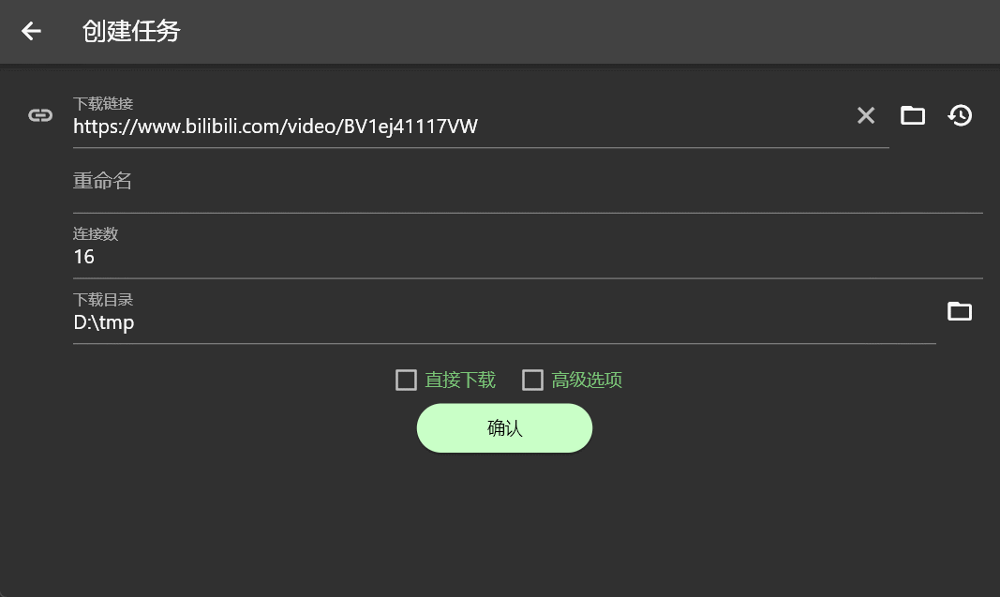
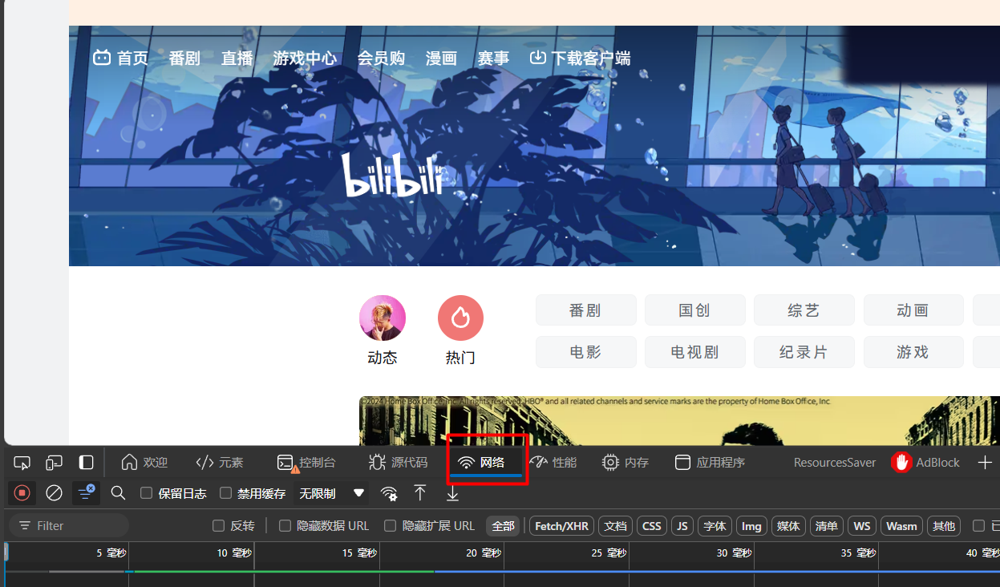
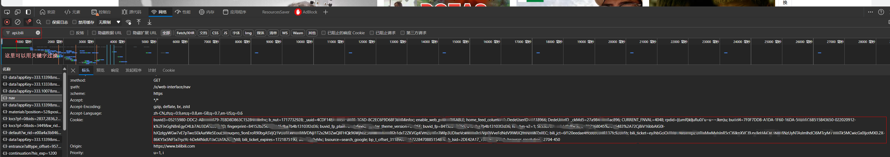
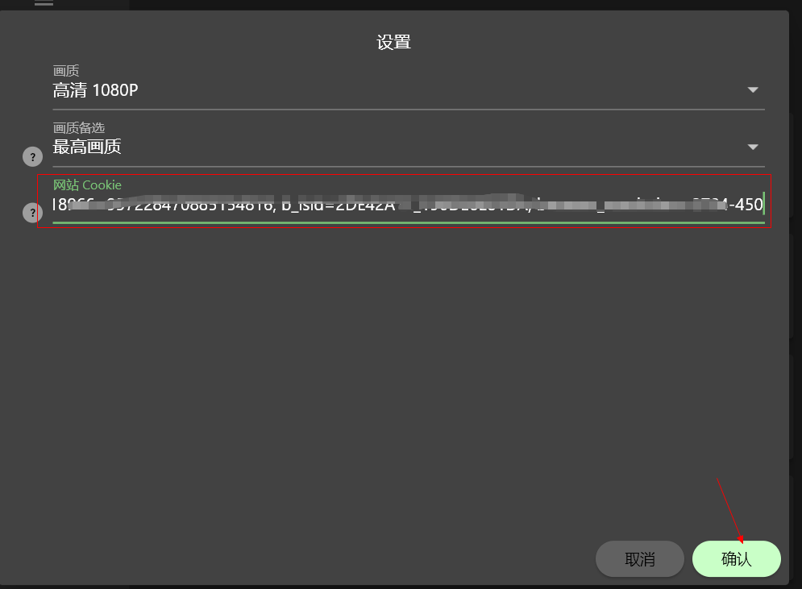

# Gopeed B站视频下载扩展

使用 [Gopeed](https://gopeed.com) 下载哔哩哔哩视频和分 P 视频。

> 需要 Gopeed 版本 >= 2.0.0。

## 功能特性

- **视频下载** — 粘贴 B 站视频链接或 `b23.tv` 分享短链即可下载。
- **分 P 批量下载** — 支持下载全部分 P、指定分 P 或分 P 范围。
- **已购课程** — 支持哔哩哔哩课堂和会员购视频课程，展示课时列表供选择，下载开始时自动刷新播放地址。
- **最高 8K 画质** — 支持选择最高 8K 画质，实际可用画质取决于视频源和账号权限。
- **自动合并音视频** — 通过 FFmpeg 自动将分离的音视频合并为一个 MP4，无需手动操作。
- **画质选择** — 支持设置画质和备选画质，以及开启 HDR、杜比视界，需视频源及账号权限支持。

## 安装

打开 Gopeed 的扩展页面，输入 `https://github.com/monkeyWie/gopeed-extension-bilibili`，点击安装。

## 使用说明

打开 Gopeed 的**创建任务**面板，粘贴 B 站视频链接，点击下载即可。以下是链接示例，请将 `BV_ID` 或 `SHORT_CODE` 替换为实际值：

| 类型           | 示例链接                                     |
| -------------- | -------------------------------------------- |
| 分享短链       | `https://b23.tv/SHORT_CODE`                  |
| 视频或全部分 P | `https://www.bilibili.com/video/BV_ID`       |
| 指定分 P       | `https://www.bilibili.com/video/BV_ID?p=2`   |
| 分 P 范围      | `https://www.bilibili.com/video/BV_ID?p=1-3` |

### 分 P 视频

不指定 `p` 参数时会解析全部分 P，可在创建任务面板选择需要下载的视频。也可以使用 `p=2-` 下载第 2 P 及之后的视频，或使用 `p=-3` 下载前 3 P。

### 课堂与会员购课程

先按下文的 Cookie 配置说明，在扩展设置中填写**购买课程账号**的 Cookie，再在 Gopeed 创建任务时粘贴完整课程链接：

| 类型               | 链接示例                                                                                             |
| ------------------ | ---------------------------------------------------------------------------------------------------- |
| 课堂课时或整套课程 | `https://www.bilibili.com/cheese/play/ep124227`                                                      |
| 课堂课程编号       | `https://www.bilibili.com/cheese/play/ss课程编号`                                                    |
| 会员购视频课程     | `https://mall.bilibili.com/lesson/play?courseId=1000625147&lessonId=180281190609920&itemId=10302975` |

默认读取整套目录，在 Gopeed 的文件列表中勾选需要下载的课时。课堂可添加 `?p=2` 或 `?p=2-5`，会员购可添加 `&p=2` 或 `&p=2-5`，只解析指定序号或范围。序号从 1 开始，以接口目录顺序为准。课程暂不支持普通分 P 的开放范围写法。

课堂使用扩展画质设置，通过 Gopeed FFmpeg 合并 DASH 音视频；会员购直接下载接口提供的整节 MP4，文件名中的 `original` 表示接口没有提供分辨率信息。会员购的 `lessonId` 可能由整套课程共用，每个课时通过 `sectionId` 区分。

只处理账号购买权限内的完整普通媒体，试看、加密媒体、目录不完整和权限失效会报错。无指定范围时跳过无权观看的课时；显式指定范围内包含无权课时则报错。课程 Cookie 仅发送到官方课程接口，不发送到媒体 CDN，也不写入任务标签；媒体 URL 会随 Gopeed 任务保存，并在开始和有限次失败重试时刷新。

**验证范围：**已完成模拟接口测试及打包检查；课堂目录已用真实公开接口核对。已购账号下的课堂/会员购下载仍需在 Gopeed 中实测，不能把单元测试通过视为真实下载验证。若接口只返回部分目录，本版本会明确报错，不会把部分目录当成整套课程。

本地测试此分支：运行 `npm ci`、`npm test`、`npm run build`，在 Gopeed 扩展页连续点击安装按钮 5 次开启桌面开发者模式，选择本仓库目录安装。若 npm 12 因锁文件中的 Git 依赖提示 `EALLOWGIT`，检查锁定的依赖来源后可用 `npm ci --allow-git=all` 安装；该依赖仍使用锁文件中的固定提交。不要将真实 Cookie 写进源码、测试文件或 Git 提交。

### 画质与 Cookie

在扩展设置中选择需要的画质；指定画质不可用时，会使用设置的备选画质。需要登录或大会员权限的画质，请配置具有相应权限的 B 站账号 Cookie。

1. 打开 B 站视频页面，按 `F12` 打开开发者工具，切换到**网络**选项卡。

2. 刷新页面，找到 `api.bilibili.com` 的请求，复制请求头中的 `cookie` 值。

3. 打开 Gopeed 的扩展设置，填写**网站 Cookie**，保存后重新创建任务。

## 声明

本项目代码全部开源，仅供学习交流使用，不得用于商业用途，如有侵权请联系作者删除。

## 相关链接

- [bili-api](https://github.com/renmu123/biliAPI)
- [Gopeed 扩展开发文档](https://docs.gopeed.com/zh/dev-extension.html)
